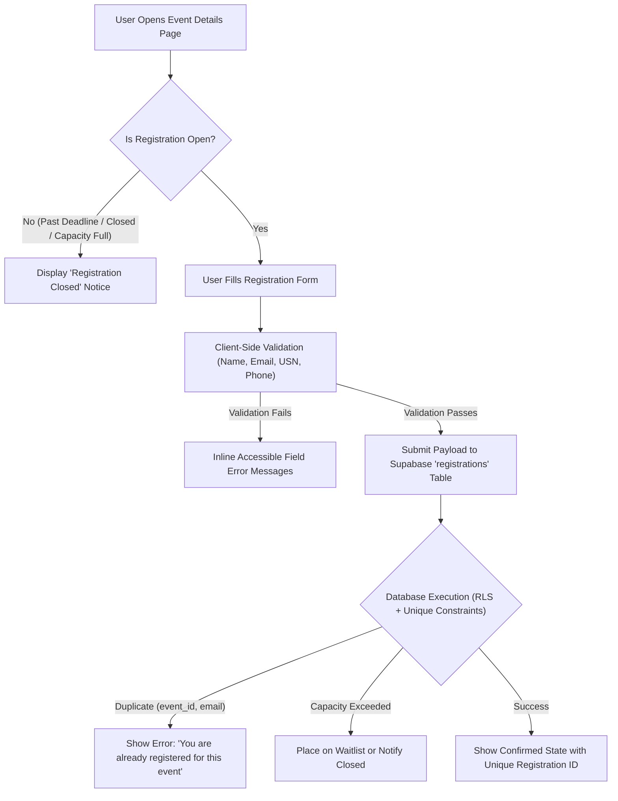
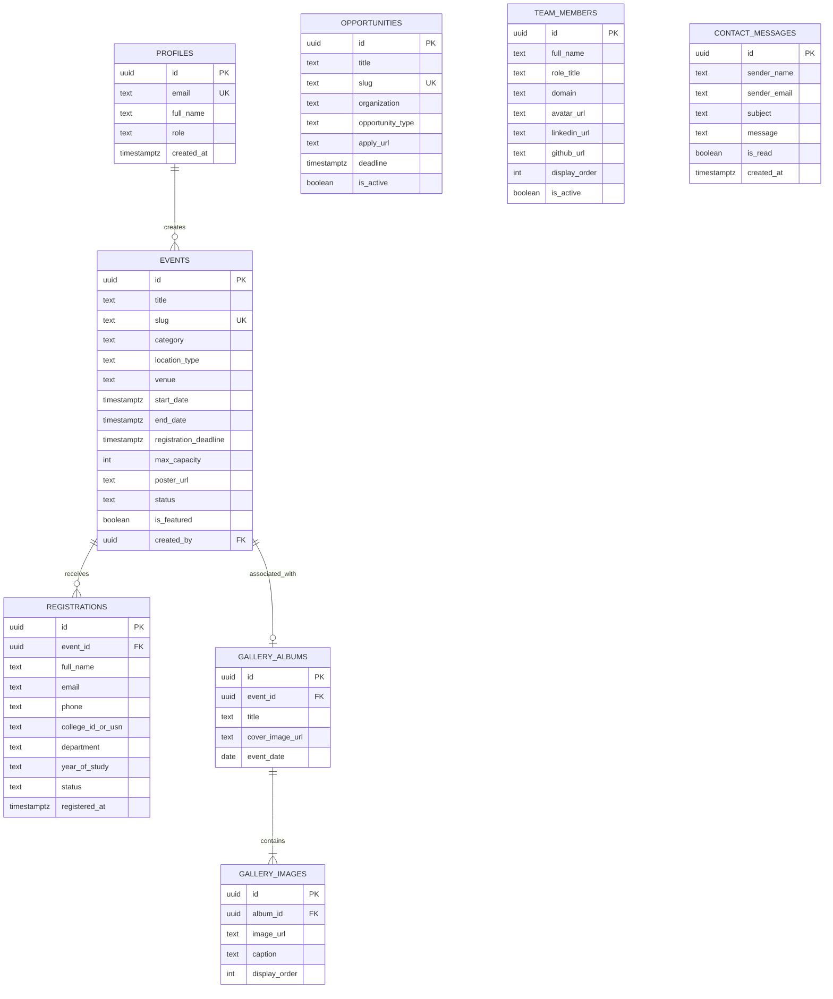

# HWI × VVITU Community Platform
## Phase 1: Software Architecture, Database Design & Engineering Specification

---

### Executive Summary

This specification defines the complete technical blueprint for the **HWI × VVITU Community Platform**—a digital hub connecting the HackWithIndia (HWI) national developer community with the student body at VVITU. 

The architecture is engineered around the core constraints:
- **Zero heavy frameworks**: Pure semantic HTML5, modern modular CSS3, and Vanilla JavaScript (ES6+ Modules).
- **Backend-as-a-Service**: Supabase (PostgreSQL 15+, Supabase Auth, Row Level Security, Supabase Storage).
- **Security-first**: Database-enforced authorization via PostgreSQL RLS policies; frontend code never acts as the security boundary.
- **Content integrity**: Strict zero-fabrication policy; zero fake metrics, placeholder warnings on pending real content.
- **Production-grade reliability**: Fully responsive, accessible (WCAG 2.1 AA), normalized database schema with relational integrity and unique constraints.

---

## 1. Detailed Product Requirements Document (PRD)

### 1.1 Product Purpose & Vision
The platform serves as the official portal for the HackWithIndia student chapter at VVITU. It bridges national hackathons, technical initiatives, and industry challenges directly to VVITU students while providing chapter organizers a frictionless, secure content and event administration interface.

### 1.2 Core Personas
1. **Student / Prospective Member (Unauthenticated Public User)**
   - Wants to explore the community's authentic mission, leadership, and upcoming hackathons/workshops.
   - Registers for specific events with instant confirmation and validation.
   - Discovers curated external and internal opportunities (grants, hackathons, open source).
   - Views authentic event photo galleries and verified team members.
   - Seeks official communication channels (Discord, WhatsApp, LinkedIn, GitHub).

2. **Event Registrant / Attendee**
   - Submits verifiable registration data (Full Name, College Email, USN/Roll Number, Department, Year of Study).
   - Receives immediate feedback: successful confirmation, waitlist notification, or duplicate submission rejection.

3. **Community Administrator / Chapter Lead (Authenticated User with `admin` role)**
   - Authenticates securely via email and password using Supabase Auth.
   - Manages the lifecycle of events (Draft, Published, Completed, Archived).
   - Reviews and exports event attendee lists (CSV format) without direct database access.
   - Creates and updates verified team member profiles, opportunities, and gallery media.
   - Moderates incoming contact and partnership inquiries.

### 1.3 High-Level Functional Requirements
- **FR-1: Public Discovery**: Deliver blazing fast, SEO-friendly static pages for Home, About, Events, Event Details, Opportunities, Team, Gallery, and Contact.
- **FR-2: Dynamic Content Hydration**: Fetch published events, active opportunities, approved gallery albums, and active team profiles via the Supabase JS client.
- **FR-3: Event Registration Engine**: Client-side validated form with server-enforced deduplication, registration capacity limits, and deadline validation.
- **FR-4: Administrative Control Center**: Secure administrative portal behind Supabase Auth and database RLS.
- **FR-5: Media Storage & CDN Delivery**: Integrated Supabase Storage buckets for event banners, team headshots, and event photo albums with strict MIME type and file size limits.

### 1.4 Non-Functional Requirements
- **Performance**: Static pages with asynchronous module hydration. Target Lighthouse Performance score ≥ 95. Page load time under 1.2 seconds on 4G connections.
- **Accessibility**: WCAG 2.1 Level AA compliance. Proper semantic headings, ARIA attributes on interactive dialogs, keyboard navigation, visible focus rings, and high-contrast color ratios.
- **Security**: 100% of tables protected by Row Level Security (RLS). Secret/Service keys never exposed. Input sanitized before insertion. Strict Content Security Policy (CSP).
- **Cross-Platform Compatibility**: Fully responsive across mobile (320px–480px), tablet (481px–1024px), laptop (1025px–1440px), and wide monitors (1441px+).

---

## 2. User Roles and Permissions Matrix

| Module / Operation | Anonymous Visitor (`anon`) | Authenticated Regular User | Authenticated Admin (`admin` role) |
| :--- | :--- | :--- | :--- |
| **View Published Events & Details** | Allowed | Allowed | Allowed |
| **View Draft / Archived Events** | Denied (RLS filtered) | Denied (RLS filtered) | Allowed |
| **Register for Event** | Allowed (Valid email required) | Allowed | Allowed |
| **View Own Registration Status** | Allowed (At submission time) | Allowed | Allowed |
| **View All Registrations / Attendee Lists** | **DENIED** | **DENIED** | Allowed |
| **Create / Update / Delete Events** | **DENIED** | **DENIED** | Allowed |
| **Manage Team Profiles** | **DENIED** | **DENIED** | Allowed |
| **Manage Opportunities & Gallery** | **DENIED** | **DENIED** | Allowed |
| **Upload to Supabase Storage** | **DENIED** | **DENIED** | Allowed (Validated file types) |
| **Assign Roles / Manage Admins** | **DENIED** | **DENIED** | Restricted to Super-Admin |

---

## 3. Application Sitemap

```
HWI × VVITU Platform
│
├── Public Pages (Static HTML + ES Modules)
│   ├── /index.html                    (Home: Hero, Mission Highlights, Featured Events, Opportunities CTA)
│   ├── /about.html                    (About: HWI National, VVITU Chapter, Values, Governance)
│   ├── /events.html                   (Events Directory: Filter by Status [Upcoming/Past] & Category)
│   ├── /event-details.html?id=:id     (Event Detail: Schedule, Speaker, Venue, Live Registration Form)
│   ├── /opportunities.html            (Opportunities Directory: Hackathons, Grants, Contests, Deadlines)
│   ├── /team.html                     (Team: Verified Chapter Leads, Core Team, Mentors)
│   ├── /gallery.html                  (Gallery: Event-organized albums and photo grid with lightboxes)
│   └── /contact.html                  (Contact: Official handles, community join links, validated inquiry form)
│
└── Administration Area (Protected by Supabase Auth + RLS)
    ├── /admin/login.html              (Admin Authentication: Email/Password, Password Reset)
    ├── /admin/dashboard.html          (Admin Command Center: Real metrics, quick actions, recent activity)
    ├── /admin/events.html             (Event Manager: Create, Edit, Toggle Draft/Published/Archived)
    ├── /admin/registrations.html      (Registrations Manager: Filter by event, status toggle, CSV export)
    ├── /admin/opportunities.html      (Opportunity Manager: Post new contests/hackathons, manage deadlines)
    ├── /admin/team.html               (Team Manager: Maintain verified member profiles and order)
    └── /admin/gallery.html            (Media Manager: Create albums, upload approved photos to storage)
```

---

## 4. Complete Feature Specification

### 4.1 Public Website Modules

#### 4.1.1 Home Page (`/index.html`)
- **Hero Section**: Dual-brand heading (`HackWithIndia × VVITU`), focused tagline, primary CTA (*Explore Events*), secondary CTA (*Join Community*).
- **Core Pillars**: Three clean cards highlighting Innovation, Peer Learning, and National Hackathons.
- **Featured Events Section**: Dynamically fetches up to 3 upcoming published events ordered by `start_date ASC`. Graceful empty state when no upcoming events exist.
- **Opportunities Spotlight**: Displays 2–3 active time-sensitive opportunities with clear deadline badges.
- **Community Call to Action**: Verified links to official Discord and WhatsApp channels.
- **Global Footer**: Copyright, official links, accreditation, disclaimers, and discreet Admin Portal link.

#### 4.1.2 About Page (`/about.html`)
- **HWI Overview**: Factual description of HackWithIndia as a national community.
- **VVITU Chapter Genesis**: Purpose and objectives within VVITU.
- **Operating Principles**: Open innovation, merit-based participation, ethical coding, student mentorship.
- **Verified Disclaimers**: Clarifies independent student community status recognized at VVITU.

#### 4.1.3 Events Directory & Event Details (`/events.html` & `/event-details.html`)
- **Filter Tabs**: `Upcoming Events`, `Past Events`, and Category filters (`Hackathon`, `Workshop`, `Tech Talk`, `Meetup`).
- **Event Card**: Title, category tag, date/time badge, venue/platform, short excerpt, registration status (`Open`, `Filling Fast`, `Closed`).
- **Detail Page**: Hero banner image, comprehensive rich description, date/time, physical venue / virtual link, speaker/mentor details, interactive registration form or registration closed notice.

#### 4.1.4 Opportunities Directory (`/opportunities.html`)
- **Cards Grid**: Title, organizer/source, opportunity type tag (`Hackathon`, `Grant`, `Fellowship`, `Hiring Challenge`), description, deadline countdown indicator, direct external apply link.
- **Filter**: All, Open, Closing Soon.

#### 4.1.5 Team Directory (`/team.html`)
- **Groupings**: Executive Leads, Technical Wing, Design & Media Wing, Outreach & Operations.
- **Member Card**: Approved headshot (or standard accessible monogram placeholder), full name, chapter role, domain badge, verified LinkedIn and GitHub icon links.
- **Zero Fabrication**: Displays only verified members; pending roles marked transparently.

#### 4.1.6 Gallery (`/gallery.html`)
- **Event Album View**: Albums linked directly to verified past events.
- **Photo Grid**: Clean masonry or responsive CSS grid with aspect-ratio management.
- **Accessible Lightbox**: High-resolution view with keyboard navigation (Esc to close, Left/Right arrow keys to navigate) and accessible alt text.

#### 4.1.7 Contact Page (`/contact.html`)
- **Official Contact Info**: Official chapter email and campus location details.
- **Community Join Links**: Official invitation links for VVITU students.
- **Inquiry Form**: Validated fields (Name, Email, Subject, Message) writing directly to `contact_messages` table via RLS.

---

### 4.2 Event Registration Workflow



---

### 4.3 Admin Portal & Management System

#### 4.3.1 Authentication & Authorization
- **Login Flow**: Clean admin login form utilizing `supabase.auth.signInWithPassword({ email, password })`.
- **Role Verification**: After authentication, the client verifies that the user holds `role = 'admin'` in the `profiles` table. Unauthorized users are immediately signed out and redirected with an audit message.
- **Session Handling**: Real-time listener `supabase.auth.onAuthStateChange` maintains valid session state, handling token refresh or automatic logout upon expiration.
- **Navigation Guard**: Reusable module `authGuard.js` invoked before mounting any `/admin/*` page.

#### 4.3.2 Admin Modules
- **Overview Dashboard (`dashboard.html`)**: Real queries displaying total published events, total registered participants, active opportunities, and quick navigation.
- **Event Management (`admin/events.html`)**: Modal/drawer for creating and editing events with poster upload directly to Supabase Storage bucket `posters`. Ability to change status between `draft`, `published`, `completed`, and `archived`.
- **Registration Management (`admin/registrations.html`)**: Dropdown to filter by event; real-time tabular list of attendees with search; toggle status (`confirmed`, `waitlisted`, `attended`, `cancelled`); button to export clean CSV.
- **Team Management (`admin/team.html`)**: Add/edit team members, reorder display order, upload verified headshots to `team-avatars` bucket.
- **Gallery Management (`admin/gallery.html`)**: Create albums, upload multi-file event photos to `gallery` bucket with metadata.

---

## 5. Recommended Folder Structure

```
hwi-vvitu/
├── index.html                       # Public Home page
├── about.html                       # About HWI & VVITU
├── events.html                      # Events listing and filters
├── event-details.html               # Event details and live registration
├── opportunities.html               # Opportunities directory
├── team.html                        # Verified team showcase
├── gallery.html                     # Event photo gallery
├── contact.html                     # Official contact and joining links
│
├── admin/                           # Protected administration area
│   ├── login.html                   # Admin authentication portal
│   ├── dashboard.html               # Administration command center
│   ├── events.html                  # Event creation and management
│   ├── registrations.html           # Participant management and CSV export
│   ├── opportunities.html           # Opportunity curation
│   ├── team.html                    # Team profile management
│   └── gallery.html                 # Media and album management
│
├── assets/                          # Static assets
│   ├── icons/                       # Feather/Lucide SVG icons
│   ├── images/                      # Fallbacks, default banners, placeholders
│   └── logos/                       # Official HWI and VVITU approved brand marks
│
├── css/                             # Modular, scalable stylesheets
│   ├── variables.css                # Color tokens, typography, spacing, elevations
│   ├── base.css                     # Reset, typography, layout container, utilities
│   ├── components.css               # Buttons, cards, badges, dialogs, forms, toasts
│   ├── responsive.css               # Global media queries and layout adaptations
│   └── admin.css                    # Admin sidebar, data tables, metric tiles, forms
│
├── js/                              # Vanilla ES6+ modules
│   ├── config.js                    # Environment constants (Supabase URL, Anon Key)
│   ├── supabaseClient.js            # Central Supabase client initialization
│   ├── auth.js                      # Authentication helper, session checks, role check
│   ├── authGuard.js                 # Admin route protector script
│   ├── main.js                      # Global scripts (navigation, mobile drawer, toasts)
│   │
│   ├── pages/                       # Page-specific frontend controllers
│   │   ├── home.js                  # Home page dynamic hydration
│   │   ├── events.js                # Events filter and card rendering
│   │   ├── eventDetails.js          # Event view and registration form logic
│   │   ├── opportunities.js         # Opportunities query and filter
│   │   ├── team.js                  # Team directory hydration
│   │   ├── gallery.js               # Gallery albums and lightbox handler
│   │   └── contact.js               # Contact form submission and validation
│   │
│   ├── admin/                       # Admin page controllers
│   │   ├── login.js                 # Admin auth handler
│   │   ├── dashboard.js             # Metrics queries and recent logs
│   │   ├── eventManager.js          # Event CRUD and poster upload
│   │   ├── registrationManager.js   # Attendee table, status toggles, CSV export
│   │   ├── opportunityManager.js    # Opportunity CRUD
│   │   ├── teamManager.js           # Team member CRUD and avatar upload
│   │   └── galleryManager.js        # Album and photo uploads
│   │
│   └── utils/                       # Shared utility helpers
│       ├── dom.js                   # Safe DOM manipulation & query helpers
│       ├── formatters.js            # Date/time, countdown, and string formatters
│       ├── toast.js                 # Accessible notification toasts
│       ├── validators.js            # Email, phone, USN regex validators
│       └── csv.js                   # CSV generation and download utility
│
├── supabase/                        # Database migrations & seed scripts
│   ├── migrations/
│   │   ├── 20261115000001_create_profiles.sql
│   │   ├── 20261115000002_create_events.sql
│   │   ├── 20261115000003_create_registrations.sql
│   │   ├── 20261115000004_create_opportunities.sql
│   │   ├── 20261115000005_create_team_members.sql
│   │   ├── 20261115000006_create_gallery.sql
│   │   ├── 20261115000007_create_contact_messages.sql
│   │   ├── 20261115000008_security_rls_policies.sql
│   │   └── 20261115000009_storage_buckets.sql
│   └── seed.sql                     # Clean seed data with verified placeholders
│
├── vercel.json                      # Vercel deployment configuration and security headers
├── .gitignore                       # Git ignore file
└── README.md                        # Documentation and setup guide
```

---

## 6. Supabase Database Schema Proposal

### 6.1 Entity Definitions & Relational Integrity

```sql
-- Enable necessary extensions
CREATE EXTENSION IF NOT EXISTS "uuid-ossp";

-- 1. Profiles Table (Extends Supabase auth.users)
CREATE TABLE public.profiles (
    id UUID PRIMARY KEY REFERENCES auth.users(id) ON DELETE CASCADE,
    email TEXT NOT NULL UNIQUE,
    full_name TEXT NOT NULL,
    role TEXT NOT NULL DEFAULT 'member' CHECK (role IN ('admin', 'moderator', 'member')),
    created_at TIMESTAMPTZ NOT NULL DEFAULT timezone('utc'::text, now()),
    updated_at TIMESTAMPTZ NOT NULL DEFAULT timezone('utc'::text, now())
);

-- 2. Events Table
CREATE TABLE public.events (
    id UUID PRIMARY KEY DEFAULT uuid_generate_v4(),
    title TEXT NOT NULL,
    slug TEXT NOT NULL UNIQUE,
    short_summary TEXT NOT NULL,
    description TEXT NOT NULL,
    category TEXT NOT NULL CHECK (category IN ('hackathon', 'workshop', 'tech_talk', 'meetup', 'competition')),
    location_type TEXT NOT NULL DEFAULT 'in_person' CHECK (location_type IN ('in_person', 'virtual', 'hybrid')),
    venue TEXT NOT NULL,
    start_date TIMESTAMPTZ NOT NULL,
    end_date TIMESTAMPTZ NOT NULL,
    registration_deadline TIMESTAMPTZ NOT NULL,
    max_capacity INTEGER CHECK (max_capacity > 0),
    poster_url TEXT,
    status TEXT NOT NULL DEFAULT 'draft' CHECK (status IN ('draft', 'published', 'completed', 'archived')),
    is_featured BOOLEAN NOT NULL DEFAULT false,
    created_by UUID REFERENCES public.profiles(id) ON DELETE SET NULL,
    created_at TIMESTAMPTZ NOT NULL DEFAULT timezone('utc'::text, now()),
    updated_at TIMESTAMPTZ NOT NULL DEFAULT timezone('utc'::text, now()),
    CONSTRAINT chk_event_dates CHECK (end_date >= start_date),
    CONSTRAINT chk_reg_deadline CHECK (registration_deadline <= end_date)
);

-- 3. Registrations Table
CREATE TABLE public.registrations (
    id UUID PRIMARY KEY DEFAULT uuid_generate_v4(),
    event_id UUID NOT NULL REFERENCES public.events(id) ON DELETE RESTRICT,
    full_name TEXT NOT NULL,
    email TEXT NOT NULL,
    phone TEXT,
    college_id_or_usn TEXT NOT NULL,
    department TEXT NOT NULL,
    year_of_study TEXT NOT NULL CHECK (year_of_study IN ('1st Year', '2nd Year', '3rd Year', '4th Year', 'Postgraduate', 'Other')),
    status TEXT NOT NULL DEFAULT 'confirmed' CHECK (status IN ('confirmed', 'waitlisted', 'attended', 'cancelled')),
    registered_at TIMESTAMPTZ NOT NULL DEFAULT timezone('utc'::text, now()),
    notes TEXT,
    -- Prevent duplicate registrations for the same event with the same email
    CONSTRAINT uq_event_participant UNIQUE (event_id, email)
);

-- 4. Opportunities Table
CREATE TABLE public.opportunities (
    id UUID PRIMARY KEY DEFAULT uuid_generate_v4(),
    title TEXT NOT NULL,
    slug TEXT NOT NULL UNIQUE,
    organization TEXT NOT NULL,
    opportunity_type TEXT NOT NULL CHECK (opportunity_type IN ('hackathon', 'internship', 'scholarship', 'workshop', 'grant', 'contest')),
    description TEXT NOT NULL,
    apply_url TEXT NOT NULL,
    deadline TIMESTAMPTZ,
    is_active BOOLEAN NOT NULL DEFAULT true,
    created_at TIMESTAMPTZ NOT NULL DEFAULT timezone('utc'::text, now()),
    updated_at TIMESTAMPTZ NOT NULL DEFAULT timezone('utc'::text, now())
);

-- 5. Team Members Table
CREATE TABLE public.team_members (
    id UUID PRIMARY KEY DEFAULT uuid_generate_v4(),
    full_name TEXT NOT NULL,
    role_title TEXT NOT NULL,
    domain TEXT NOT NULL CHECK (domain IN ('lead', 'technical', 'design', 'events', 'outreach', 'faculty')),
    bio TEXT,
    avatar_url TEXT,
    linkedin_url TEXT,
    github_url TEXT,
    display_order INTEGER NOT NULL DEFAULT 0,
    is_active BOOLEAN NOT NULL DEFAULT true,
    created_at TIMESTAMPTZ NOT NULL DEFAULT timezone('utc'::text, now()),
    updated_at TIMESTAMPTZ NOT NULL DEFAULT timezone('utc'::text, now())
);

-- 6. Gallery Albums Table
CREATE TABLE public.gallery_albums (
    id UUID PRIMARY KEY DEFAULT uuid_generate_v4(),
    event_id UUID REFERENCES public.events(id) ON DELETE SET NULL,
    title TEXT NOT NULL,
    description TEXT,
    cover_image_url TEXT,
    event_date DATE,
    created_at TIMESTAMPTZ NOT NULL DEFAULT timezone('utc'::text, now())
);

-- 7. Gallery Images Table
CREATE TABLE public.gallery_images (
    id UUID PRIMARY KEY DEFAULT uuid_generate_v4(),
    album_id UUID NOT NULL REFERENCES public.gallery_albums(id) ON DELETE CASCADE,
    image_url TEXT NOT NULL,
    caption TEXT,
    display_order INTEGER NOT NULL DEFAULT 0,
    uploaded_at TIMESTAMPTZ NOT NULL DEFAULT timezone('utc'::text, now())
);

-- 8. Contact Messages Table
CREATE TABLE public.contact_messages (
    id UUID PRIMARY KEY DEFAULT uuid_generate_v4(),
    sender_name TEXT NOT NULL,
    sender_email TEXT NOT NULL,
    subject TEXT NOT NULL,
    message TEXT NOT NULL,
    is_read BOOLEAN NOT NULL DEFAULT false,
    created_at TIMESTAMPTZ NOT NULL DEFAULT timezone('utc'::text, now())
);
```

### 6.2 Database Indexes for Query Optimization
```sql
CREATE INDEX idx_events_status_dates ON public.events(status, start_date);
CREATE INDEX idx_events_slug ON public.events(slug);
CREATE INDEX idx_registrations_event_id ON public.registrations(event_id);
CREATE INDEX idx_registrations_email ON public.registrations(email);
CREATE INDEX idx_opportunities_active_deadline ON public.opportunities(is_active, deadline);
CREATE INDEX idx_team_members_active_order ON public.team_members(is_active, display_order);
CREATE INDEX idx_gallery_images_album_order ON public.gallery_images(album_id, display_order);
```

---

## 7. Entity Relationship Diagram (ERD)



---

## 8. Row Level Security (RLS) Policy Proposal

### 8.1 Administrative Helper Function
To avoid recursive RLS checks and provide high-performance role verification, we implement a `SECURITY DEFINER` function:

```sql
CREATE OR REPLACE FUNCTION public.is_admin()
RETURNS BOOLEAN AS $$
BEGIN
  RETURN EXISTS (
    SELECT 1 FROM public.profiles
    WHERE id = auth.uid() AND role = 'admin'
  );
END;
$$ LANGUAGE plpgsql SECURITY DEFINER;
```

### 8.2 Table Policies

#### Profiles Table
```sql
ALTER TABLE public.profiles ENABLE ROW LEVEL SECURITY;

-- Users can view their own profile; Admins can view all profiles
CREATE POLICY "Profiles viewable by self and admins"
ON public.profiles FOR SELECT
USING (auth.uid() = id OR public.is_admin());

-- Only admins can update user roles
CREATE POLICY "Admins can update profiles"
ON public.profiles FOR UPDATE
USING (public.is_admin())
WITH CHECK (public.is_admin());
```

#### Events Table
```sql
ALTER TABLE public.events ENABLE ROW LEVEL SECURITY;

-- Public read for published/completed events
CREATE POLICY "Public can view published and completed events"
ON public.events FOR SELECT
USING (status IN ('published', 'completed'));

-- Admins can view all events (including drafts & archived)
CREATE POLICY "Admins can view all events"
ON public.events FOR SELECT
TO authenticated
USING (public.is_admin());

-- Only admins can insert, update, or delete events
CREATE POLICY "Admins can manage events"
ON public.events FOR ALL
TO authenticated
USING (public.is_admin())
WITH CHECK (public.is_admin());
```

#### Registrations Table
```sql
ALTER TABLE public.registrations ENABLE ROW LEVEL SECURITY;

-- Anyone can submit a registration for an active, published event before deadline
CREATE POLICY "Public can register for open published events"
ON public.registrations FOR INSERT
WITH CHECK (
    EXISTS (
        SELECT 1 FROM public.events
        WHERE id = registrations.event_id
          AND status = 'published'
          AND registration_deadline > timezone('utc'::text, now())
    )
);

-- Only Admins can view attendee records (strict privacy protection)
CREATE POLICY "Only admins can view registrations"
ON public.registrations FOR SELECT
TO authenticated
USING (public.is_admin());

-- Only Admins can update registration status
CREATE POLICY "Only admins can update registrations"
ON public.registrations FOR UPDATE
TO authenticated
USING (public.is_admin())
WITH CHECK (public.is_admin());

-- Only Admins can delete registrations
CREATE POLICY "Only admins can delete registrations"
ON public.registrations FOR DELETE
TO authenticated
USING (public.is_admin());
```

#### Opportunities Table
```sql
ALTER TABLE public.opportunities ENABLE ROW LEVEL SECURITY;

CREATE POLICY "Public can view active opportunities"
ON public.opportunities FOR SELECT
USING (is_active = true);

CREATE POLICY "Admins can manage opportunities"
ON public.opportunities FOR ALL
TO authenticated
USING (public.is_admin())
WITH CHECK (public.is_admin());
```

#### Team Members Table
```sql
ALTER TABLE public.team_members ENABLE ROW LEVEL SECURITY;

CREATE POLICY "Public can view active team members"
ON public.team_members FOR SELECT
USING (is_active = true);

CREATE POLICY "Admins can manage team members"
ON public.team_members FOR ALL
TO authenticated
USING (public.is_admin())
WITH CHECK (public.is_admin());
```

#### Gallery Albums & Images
```sql
ALTER TABLE public.gallery_albums ENABLE ROW LEVEL SECURITY;
ALTER TABLE public.gallery_images ENABLE ROW LEVEL SECURITY;

CREATE POLICY "Public can view gallery albums"
ON public.gallery_albums FOR SELECT
USING (true);

CREATE POLICY "Public can view gallery images"
ON public.gallery_images FOR SELECT
USING (true);

CREATE POLICY "Admins can manage gallery albums"
ON public.gallery_albums FOR ALL
TO authenticated
USING (public.is_admin())
WITH CHECK (public.is_admin());

CREATE POLICY "Admins can manage gallery images"
ON public.gallery_images FOR ALL
TO authenticated
USING (public.is_admin())
WITH CHECK (public.is_admin());
```

#### Contact Messages Table
```sql
ALTER TABLE public.contact_messages ENABLE ROW LEVEL SECURITY;

-- Anyone can submit a contact inquiry
CREATE POLICY "Public can submit contact message"
ON public.contact_messages FOR INSERT
WITH CHECK (true);

-- Only admins can read and mark inquiries
CREATE POLICY "Admins can view and manage contact messages"
ON public.contact_messages FOR ALL
TO authenticated
USING (public.is_admin())
WITH CHECK (public.is_admin());
```

### 8.3 Supabase Storage Bucket Policies
Three designated buckets:
1. `posters` (Public read; admin-only upload/delete; max size 5MB; image/jpeg, image/png, image/webp)
2. `team-avatars` (Public read; admin-only upload/delete; max size 2MB; image/jpeg, image/png, image/webp)
3. `gallery` (Public read; admin-only upload/delete; max size 10MB; image/jpeg, image/png, image/webp)

---

## 9. Frontend Architecture & Design System

### 9.1 Design System Tokens (Light Theme Only)
A clean, collegiate-yet-modern aesthetic utilizing pure CSS custom properties in `variables.css`:

```css
:root {
  /* Color Palette */
  --color-primary: #0A2540;       /* Deep Navy / Authority */
  --color-primary-hover: #071C30;
  --color-accent: #0066FF;        /* Electric Tech Blue */
  --color-accent-hover: #0052CC;
  --color-accent-subtle: #EBF3FF;
  
  --color-bg-body: #FFFFFF;       /* Clean White */
  --color-bg-surface: #F8FAFC;    /* Soft Grey Section Background */
  --color-bg-card: #FFFFFF;
  --color-bg-input: #FFFFFF;
  
  --color-text-primary: #1E293B;  /* Slate 800 */
  --color-text-secondary: #475569;/* Slate 600 */
  --color-text-muted: #94A3B8;    /* Slate 400 */
  --color-text-inverted: #FFFFFF;
  
  --color-border: #E2E8F0;        /* Subtle crisp borders */
  --color-border-focus: #0066FF;
  
  /* Status Colors */
  --color-success: #10B981;
  --color-success-bg: #ECFDF5;
  --color-warning: #F59E0B;
  --color-warning-bg: #FFFBEB;
  --color-error: #EF4444;
  --color-error-bg: #FEF2F2;
  
  /* Typography */
  --font-family-sans: -apple-system, BlinkMacSystemFont, "Segoe UI", Roboto, "Helvetica Neue", Arial, sans-serif;
  --font-family-mono: ui-monospace, SFMono-Regular, Menlo, Monaco, Consolas, monospace;
  
  /* Elevations (Subtle & Restrained) */
  --shadow-sm: 0 1px 2px 0 rgba(0, 0, 0, 0.05);
  --shadow-md: 0 4px 6px -1px rgba(0, 0, 0, 0.07), 0 2px 4px -1px rgba(0, 0, 0, 0.04);
  --shadow-lg: 0 10px 15px -3px rgba(0, 0, 0, 0.08), 0 4px 6px -2px rgba(0, 0, 0, 0.03);
  
  /* Transitions */
  --transition-fast: 150ms cubic-bezier(0.4, 0, 0.2, 1);
  --transition-normal: 250ms cubic-bezier(0.4, 0, 0.2, 1);
}
```

### 9.2 Modular JavaScript Strategy
No bundlers or Node.js build dependencies are required. Modern browsers natively support ES modules (`type="module"`).
- **`config.js`**: Central configuration object reading environment settings.
- **`supabaseClient.js`**: Imports `@supabase/supabase-js` via ESM from `https://esm.sh/@supabase/supabase-js@2` or official CDN, exposing a singleton client.
- **`authGuard.js`**: Self-executing script on `/admin/*` pages that checks current session and admin role, immediately redirecting unauthenticated or non-admin attempts.
- **`toast.js`**: Universal accessible toast notification queue with `role="alert"` and auto-dismiss.
- **`validators.js`**: Comprehensive client-side validators for email syntax, Indian phone numbers (`^[6-9]\d{9}$`), and university registration/USN patterns.

---

## 10. Development Roadmap (10 Phases)

```mermaid
flowchart LR
    P1["1. Architecture & Specs"] --> P2["2. DB & RLS Migrations"]
    P2 --> P3["3. CSS Design System"]
    P3 --> P4["4. Public Web Pages"]
    P4 --> P5["5. Supabase Integration"]
    P5 --> P6["6. Registration Engine"]
    P6 --> P7["7. Admin Auth & Guard"]
    P7 --> P8["8. Admin CRUD & Storage"]
    P8 --> P9["9. Security Audit & QA"]
    P9 --> P10["10. Deployment & Handover"]
```



1. **Phase 1: Product Discovery & Architecture (Current)**
   - Deliver complete specifications, database schema, RLS policies, and project plan.
   - Secure approval before any code implementation.
2. **Phase 2: Database Design & RLS Security Policies**
   - Write SQL migration scripts in `/supabase/migrations/`.
   - Setup tables, constraints, foreign keys, and indexes.
   - Configure RLS policies and test permission checks.
3. **Phase 3: Frontend Design System & Component Library**
   - Implement `variables.css`, `base.css`, `components.css`, and `responsive.css`.
   - Create accessible button systems, cards, form inputs, modal dialogs, and skeleton loaders.
4. **Phase 4: Public Website Implementation**
   - Code semantic HTML5 pages for Home, About, Events, Event Details, Opportunities, Team, Gallery, and Contact.
   - Ensure clean placeholder states for all modules with verified copy.
5. **Phase 5: Supabase Client Integration**
   - Wire `supabaseClient.js` to public pages.
   - Implement dynamic data hydration for upcoming events, opportunities, team members, and albums.
6. **Phase 6: Event Registration Workflow**
   - Build client-side form validation and async submission handling.
   - Implement duplicate registration handling, capacity check handling, and user confirmation feedback.
7. **Phase 7: Authentication & Protected Admin Dashboard**
   - Implement admin login, session persistence, automatic token renewal, and `authGuard.js`.
   - Build admin overview metrics dashboard.
8. **Phase 8: Content Management & Media Storage**
   - Build Event Manager (CRUD + file upload to `posters` bucket).
   - Build Registration Manager (data table, search/filter, status toggle, CSV export).
   - Build Team Manager, Opportunity Manager, and Gallery Manager.
9. **Phase 9: Comprehensive Testing & Security Audit**
   - Verify zero privilege escalation through direct API calls.
   - Conduct cross-browser, responsive, and WCAG accessibility testing.
10. **Phase 10: Production Deployment & Handover**
    - Deploy to Vercel with security headers and caching configuration.
    - Provide complete operations and administrator user manuals.

---

## 11. Testing Strategy

### 11.1 Functional & User Flow Testing
- **Event Filtering**: Verify category and status filters accurately segment data.
- **Registration Deduplication**: Verify that submitting duplicate `(event_id, email)` combinations reliably triggers the expected constraint error (`23505`) and displays a clear message to the user.
- **Form Validation**: Test invalid emails, empty fields, malformed phone numbers, and oversized inputs.
- **Admin Workflow**: Verify event creation, publishing toggle, and attendee list CSV export with real data.

### 11.2 Security & Penetration Testing
- **Direct API Penetration**: Attempt to execute `INSERT`, `UPDATE`, and `DELETE` on `events` using the public `anon` key via direct fetch requests to ensure PostgreSQL RLS blocks the requests with HTTP 401/403.
- **Registration Snooping**: Attempt to `SELECT` from `registrations` using the `anon` key to verify that no participant emails, phone numbers, or USNs are exposed.
- **Privilege Escalation**: Attempt to update `profiles.role` to `'admin'` using a non-admin token to ensure policy blocks unauthorized role elevation.
- **Storage Penetration**: Attempt to upload a non-image file (e.g., `.exe` or `.html`) to storage buckets to verify MIME type rejection.

### 11.3 Accessibility & Cross-Browser Verification
- Run automated audits with Lighthouse and axe-core targeting a score ≥ 95.
- Verify full keyboard tab order and accessible focus indicators on all interactive elements.
- Verify screen-reader announcements on form submission, async errors, and toast notifications.
- Test rendering across Chromium (Chrome/Edge), Gecko (Firefox), and WebKit (Safari on macOS/iOS).

---

## 12. Deployment Plan

### 12.1 Hosting Platform: Vercel Static Deployment
- Static zero-build deployment or clean lightweight bundling.
- Configuration file `vercel.json` enforcing strict security response headers:
  - `Content-Security-Policy`: Restricting scripts to self, CDN for Supabase JS, and Supabase endpoints.
  - `X-Frame-Options: DENY` (Clickjacking prevention).
  - `X-Content-Type-Options: nosniff`.
  - `Referrer-Policy: strict-origin-when-cross-origin`.
  - `Permissions-Policy: camera=(), microphone=(), geolocation=()`.

### 12.2 Environment Configuration
- `SUPABASE_URL`: Public project URL.
- `SUPABASE_ANON_KEY`: Public client-safe anon key.
- **Never store `SUPABASE_SERVICE_ROLE_KEY` in frontend source code or static deployment environments.**

---

## 13. Information & Assets Required from Project Owner

To maintain complete content integrity and avoid any fabricated information, the following assets and data are requested from the project owner:

1. **Brand Assets & Typography**:
   - Official vector logo / high-resolution PNG for HackWithIndia (HWI).
   - Official crest / logo for VVITU.
   - Any official color guidelines or usage rules (if available).
2. **Community Identity & Copy**:
   - Verified mission statement and charter for the VVITU chapter.
   - Official faculty coordinator name and department (for verification and contact page).
   - Official chapter leads / core committee roster (Name, Role, Domain, LinkedIn, GitHub, approved headshot photograph).
3. **Official Communication Links**:
   - Official Discord server invitation link.
   - Official WhatsApp community invite link.
   - Official chapter LinkedIn page, GitHub organization, and contact email.
4. **Initial Events & Schedule**:
   - Confirmed inaugural event details (Title, date, venue, category, description, poster graphic) if available, or confirmation to initialize with clean empty states.
5. **Supabase Project Credentials**:
   - Supabase Project URL and Public `anon` API Key for database connectivity.

---
*Specification prepared for HWI × VVITU community review and phase gate approval.*
